# Sprint 2 Test Report: Module 4 (Assignments & Submissions)

Tester: Cheryl | Branch tested: feature/m04-sprint-2-submissions (PR #14) | Date: 2026-11-10

Environment: Windows, Bun 1.4.4, Microsoft Edge, app run with `bun run dev` on http://localhost:3000

## Automated tests

| Command | Result |
|---|---|
| `bun test ./src/modules/04-assignments/` | 62 passed, 0 failed (8 files) |
| `bun run check` | 118 passed, 0 failed (14 files). Lint, typecheck and module sanity check all OK (all 12 modules load) |

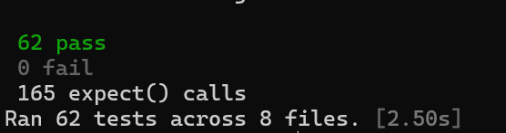

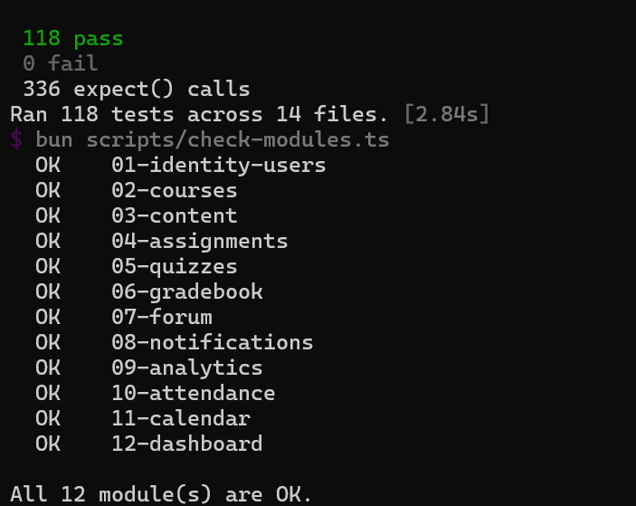

## Manual tests

Upload page used: /04-assignments/assignments/assignment-001/submissions

| # | Test case | Steps | Expected | Actual | Pass/Fail |
|---|---|---|---|---|---|
| 1 | Upload .txt | Choose small.txt, click Submit file | Receipt with file name and time | 303 then 200. Receipt shows file small.txt, a Receipt ID and Received at 2026-11-10T16:21:04.002Z (UTC) | Pass |
| 2 | Upload .pdf | Choose small.pdf, click Submit file | Receipt | 303 then 200. Receipt shows small.pdf and Received at 2026-11-10T16:23:24.762Z (UTC) | Pass |
| 3 | Download file | Click Download submitted file on the receipt | Same file comes back | 200, 28 bytes, content `%PDF-1.4 small sample file` matches the original. Minor issue: saved as `file` with no extension (see Issues) | Pass (minor issue) |
| 4 | Refresh receipt | Press F5 on the receipt page | Receipt still works, no double upload | Single 200 request, same Receipt ID and time, no 303 or new upload | Pass |
| 5 | No file | Browser: submit with no file. Terminal: `curl.exe -i -F "x=y"` to the submissions URL | 400 | Browser blocks with "Please select a file." Direct request returns 400 Bad Request with "Choose a non-empty file." and no receipt | Pass |
| 6 | Empty file | Upload empty.txt | 400 | 400, message "Choose a non-empty file.", no receipt | Pass |
| 7 | Wrong file type | Upload test.docx, then test.jpg | 415 | 415 for both, message "Choose a PDF or TXT file.", no receipt | Pass |
| 8 | File over 5 MB | Upload big.txt (6,000,000 bytes) | 413 | 413, message "Files must be 5 MB or smaller.", no receipt | Pass |
| 9 | Receipt under wrong assignment | Open the small.pdf receipt URL with assignment-001 changed to assignment-002 | 404 | 404, page says "Submission not found" | Pass |
| 10 | Two files at once | `curl.exe -i -F "file=@small.txt" -F "file=@small.pdf"` to the submissions URL | 400 | HTTP/1.1 400 Bad Request | Pass |

Result: 10 of 10 manual tests passed (1 with a minor issue).

## Screenshots

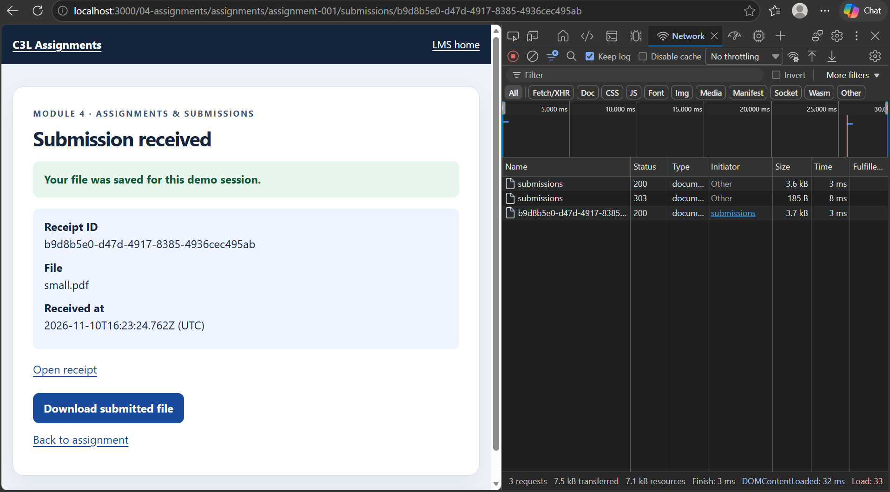

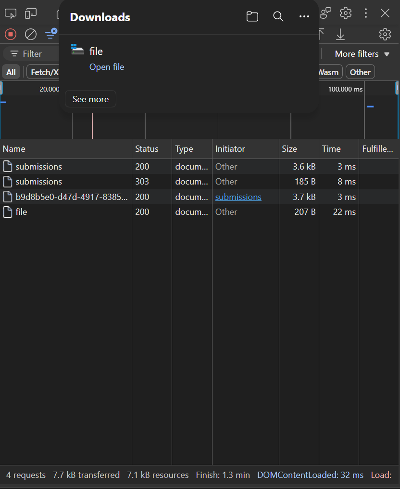

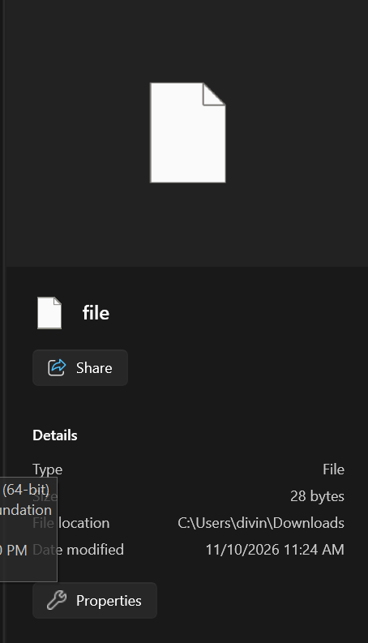

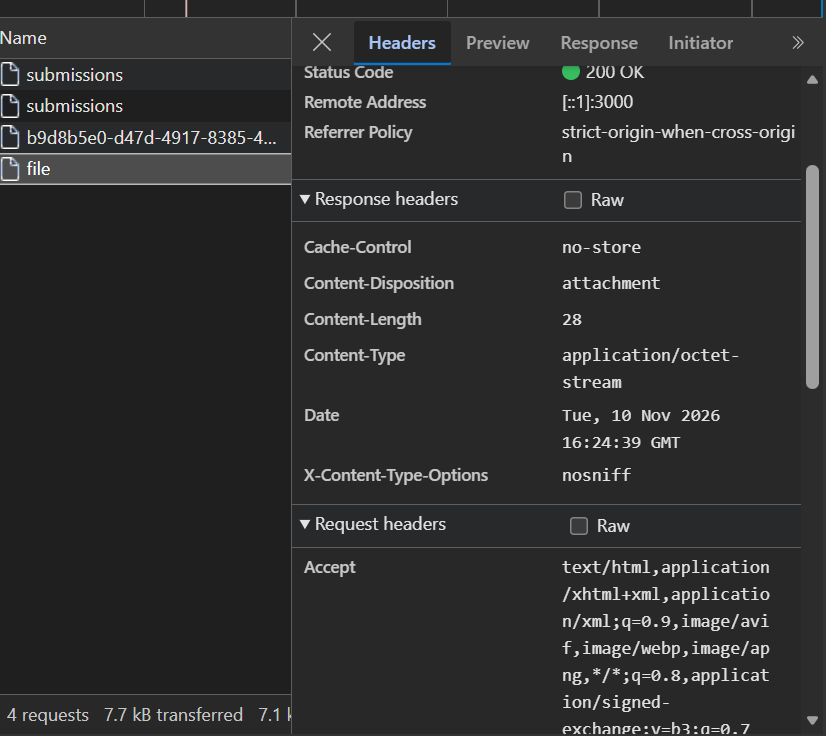

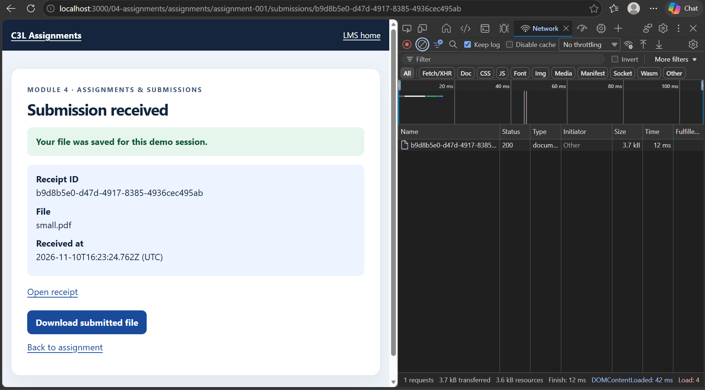

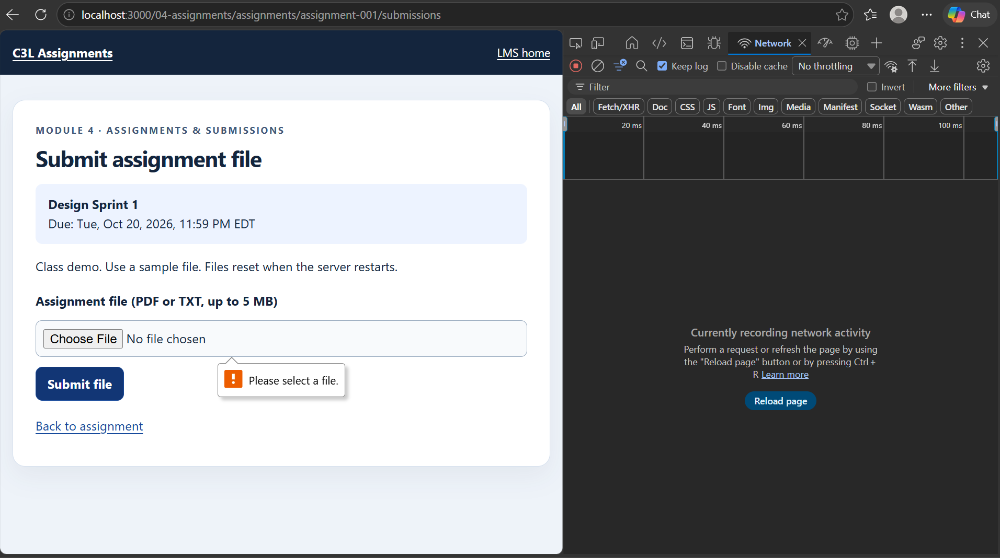

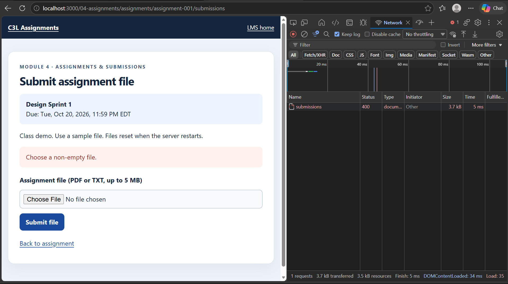

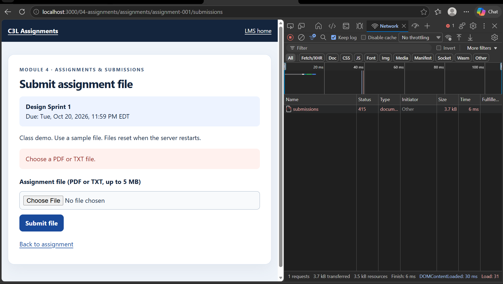

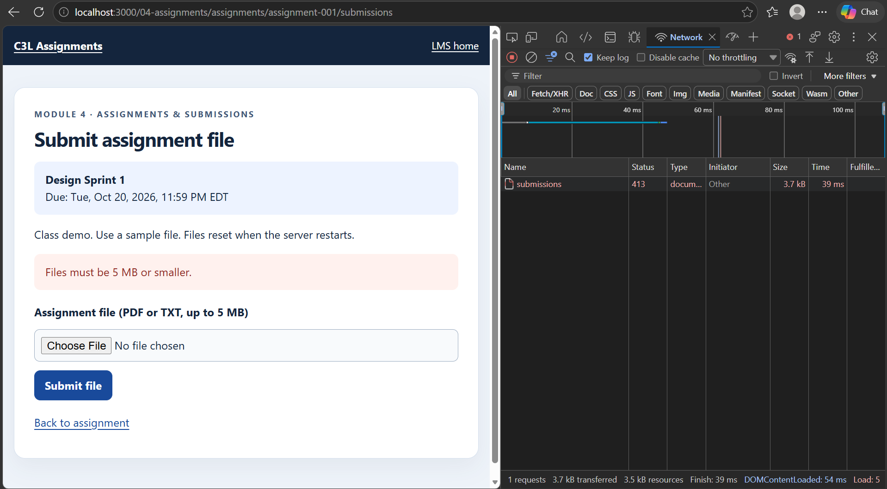

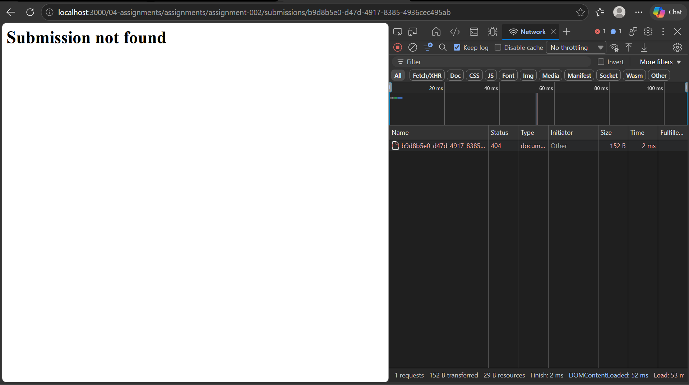

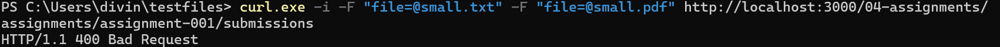

## Issues and observations

1. **Downloaded file loses its name (minor).** The download response header is `Content-Disposition: attachment` with no filename, so the browser saves the file as `file` with no extension. The bytes are correct. GitHub Issue: (add link)
2. **Plain 404 page (cosmetic).** The "Submission not found" page is unstyled text, unlike the other error pages.
3. **Browser check vs server check.** The form blocks an empty submit in the browser, and the server also rejects it with 400 when called directly.
4. **Lint notice (info only).** `bun run check` shows a Biome deprecation notice about biome.json. It is not an error and is outside Module 4.
5. Files are stored in memory and clear when the server restarts. This is expected for Sprint 2.
